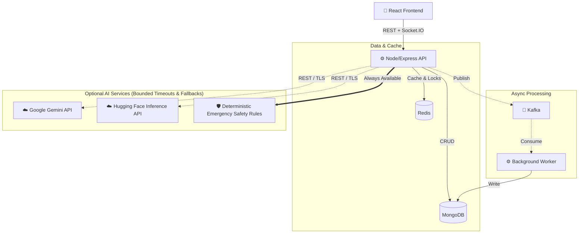

<p align="center">
  
</p>

<h1 align="center" style="font-size: 3rem; font-weight: 800;">MediPulse</h1>

<p align="center">
  <b>A next-generation healthcare SaaS platform combining AI triage, real-time telemedicine, and smart OPD management.</b>
</p>

<p align="center">
  <a href="https://www.medipulse.live/"><b>🌍 Live Demo</b></a> •
  <a href="#-core-features"><b>✨ Features</b></a> •
  <a href="#-tech-stack"><b>🛠️ Tech Stack</b></a> •
  <a href="#-getting-started"><b>🚀 Getting Started</b></a>
</p>

<p align="center">
  
  
  
  
  
</p>

> ⚠️ **Clinical Decision Support Disclaimer:** MediPulse AI features provide non-diagnostic administrative assistance, pre-consultation intake summaries, and draft note formatting. All AI-generated outputs are explicitly marked as preliminary drafts requiring review, verification, and approval by a licensed medical practitioner. MediPulse does not make autonomous clinical diagnoses or automated prescription orders. All OPD, queue, laboratory, and pharmacy operations operate reliably offline without AI dependencies.

<hr>

## 🌟 What is MediPulse?

MediPulse bridges the gap between **hospitals, doctors, and patients** in one unified ecosystem. It serves as:
- 🧑‍⚕️ **A modern healthcare portal** for patients to find doctors and book appointments.
- 🏥 **An advanced admin suite** for hospitals to manage staff, queues, laboratories, pharmacy, and OPDs.
- 🤖 **An AI Copilot** for doctors to draft clinical documentation and assist with pre-consultation intake.

By combining multi-tenant hospital operations, real-time queues, and peer-to-peer WebRTC telemedicine, MediPulse reduces patient wait times and streamlines clinical workflows.

---

## ✨ Core Features

### 🤖 AI Pre-Triage & Clinical Safety
- **Deterministic Emergency Overrides (Primary Safety Layer)** — Immediate rule-based screening for critical red-flag keywords (e.g., chest pain, breathing difficulty, stroke symptoms) that flags immediate high-urgency alerts without waiting for external AI.
- **Conversational Pre-Intake Assistant** — Optional multi-turn intake chat powered by Google Gemini that synthesizes patient-reported complaints, duration, and severity into structured drafts for clinician review.
- **Experimental Inference Client** — Direct client integration for Hugging Face inference models (triage and specialty classification) with bounded timeouts.
- **Doctor Documentation Drafts (SOAP Notes)** — AI-generated consultation drafts requiring clinician review, edits, and recorded sign-off before entering the medical record.
- **Graceful Offline Fallback** — When external AI models are unreachable or unconfigured, appointments, OPD check-ins, and documentation continue seamlessly via deterministic fallbacks.

### 🎥 WebRTC Video Consultations & Doctor Copilot
- **Peer-to-Peer Telemedicine** — Direct WebRTC video/audio with no third-party meeting links. Socket.IO handles signalling (offer/answer/ICE) and presence.
- **Robust Audio & Video** — Echo cancellation, noise suppression, and auto-gain control. Graceful degradation: video → audio-only → placeholder canvas track.
- **Live Doctor Copilot** — Streams consultation notes, flags patient allergies against records, and generates draft **SOAP notes** for clinician verification.
- **In-Call Chat & Reports Viewer** — Side panels for messaging and reviewing patient uploaded reports without leaving the call.

### 🏥 Multi-Tenant Hospitals & Smart OPD
- **Role-Based Access Control (RBAC)** — 7 staff roles including `HOSPITAL_ADMIN`, `DEPARTMENT_HEAD`, `DOCTOR`, `NURSE`, `RECEPTIONIST`, `LAB_SUPERVISOR`, and `PHARMACIST`.
- **Live OPD Queues** — Atomic per-hospital token sequences, real-time position updates over Socket.IO, and dedicated consoles for doctors and nursing stations.
- **Identity Resolution** — Queues and appointments stay in sync across a doctor's independent practice and their linked hospital-staff profile.

### 💳 Virtual Payment Gateway
- **Concurrency-Safe Ledger** — Redis distributed locks (`SET NX PX`) acquired in **deterministic sorted order** to prevent deadlocks, wrapped in **atomic MongoDB multi-document transactions**.
- **Event-Driven Architecture** — Every payment, refund, wallet update, notification, and appointment booking publishes to **8 Kafka topics** consumed by a separate worker process.

---

## 📊 At a Glance

| Metric | Count | Metric | Count |
|---|---|---|---|
| 🔌 **REST endpoints** | 135 across 20 modules | 🗄️ **Mongoose models** | 24 |
| 🎮 **Express controllers** | 22 | ⚙️ **Backend services** | 12 |
| ⚡ **Socket.IO events** | 15 | ⚛️ **React components** | 48 (38 client routes) |
| 📨 **Kafka topics** | 8 | 🛡️ **Staff Roles (RBAC)** | 7 |

---

## 🧩 Architecture

Core care and operations are decoupled from optional AI services. External cloud AI providers (Gemini, Hugging Face) are accessed over HTTP with defensive bounded timeouts and deterministic offline fallbacks.



### 🛡️ Layered Fallback Strategy
1. **Deterministic Safety Rules** (Immediate red-flag keyword screening natively in Node.js for emergency overrides)
2. **Optional Cloud AI** (Intake drafts and SOAP note formatting when configured and responsive)
3. **Deterministic Intake Fallback** (Surfaces verbatim patient complaints with review-required flags when AI is offline)

---

## 🛠️ Tech Stack

| Layer | Technologies |
|---|---|
| **🎨 Frontend** | React, Vite, React Router, Tailwind CSS v4, Axios, Lucide, jsPDF |
| **⚙️ Backend** | Node.js, Express, JWT, Google OAuth, Nodemailer |
| **🗄️ Database** | MongoDB + Mongoose (multi-document transactions) |
| **⚡ Cache & Locks**| Redis (state caching, distributed locks, TTL keys) |
| **📨 Messaging** | Apache Kafka (KafkaJS) — 8 topics, producer + consumer worker |
| **📞 Real-time** | Socket.IO (queues, presence, signalling), WebRTC (media) |
| **🧠 AI / Decision Support** | Google Gemini 2.5 Flash, Hugging Face Inference Client, Rule-Based Triage Engine *(Roadmap: fine-tuned microservices per [PRODUCTION_ROADMAP.md](PRODUCTION_ROADMAP.md))* |
| **☁️ DevOps** | Docker, Docker Compose, Render, Vercel |

---

## 🚀 Getting Started

Use [docs/DEVELOPMENT.md](docs/DEVELOPMENT.md) for the isolated local MongoDB replica set, Redis/Kafka, host development and regression commands. Docker Compose 2.24.4+ and a running Docker Engine are required.

```bash
docker compose up --build
```

The Docker frontend is at `http://localhost:8081`; the API is at `http://localhost:8080`. Local defaults use only `medipulse_dev` with mail disabled. Host development uses `.env.local` templates; do not copy deployment credentials into local test configuration.

---

## 🛣️ Roadmap

- ✅ **Phase 1** — Multi-tenant models, OPD tokens, WebRTC consults, virtual wallet.
- ✅ **Phase 2** — AI triage, TriageBERT integration, SOAP copilot, Kafka payment events.
- 🚧 **Phase 3 (Next)** — Lab orders, report uploads, QR-verified digital prescriptions, family record manager.
- ⏳ **Phase 4** — Swap the heuristic ranking stub with trained LightGBM LambdaMART models using live interaction data; wait-time prediction.
- ⏳ **Phase 5** — ABHA (Ayushman Bharat Health Account) integration, enterprise API access, mobile rollout.

---

<p align="center">
  Made with ❤️ by the MediPulse Team
</p>
