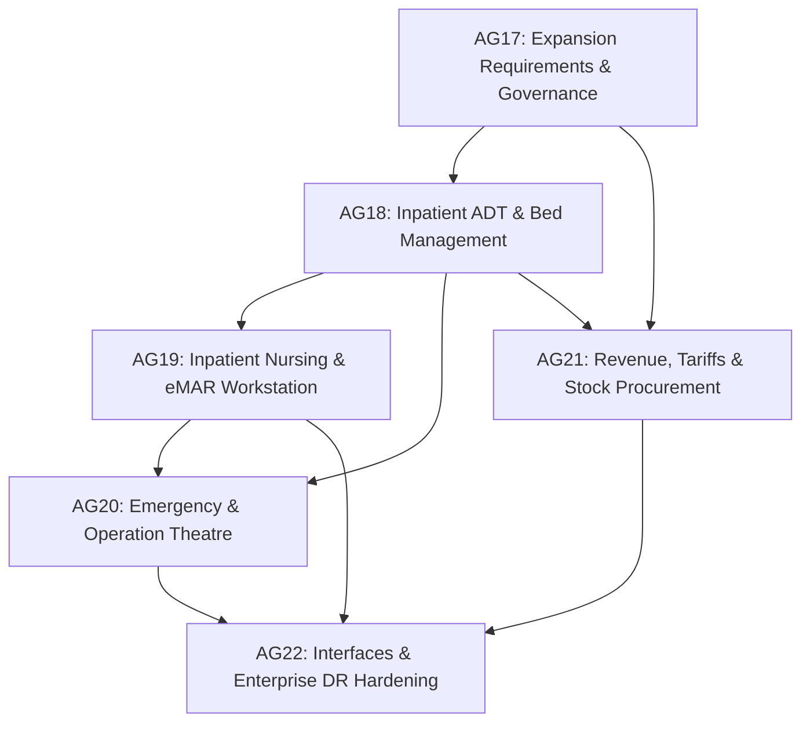

# MediPulse Enterprise Hospital Expansion Plan & Architectural Specification

**Document Version:** 2.0.0  
**Date:** 21 October 2026  
**Status:** Approved Architectural Specification & Milestone Definition  
**Authors:** MediPulse Engineering, Clinical Informatics & Enterprise Architecture  
**Execution Context:** Task AG17 / Enterprise Hospital Track (AG17–AG22)

---

## 1. Executive Summary & Purpose

MediPulse has completed and verified its core outpatient (OPD), telemedicine, diagnostic laboratory, pharmacy fulfillment, and multi-tenant SaaS foundation (Phases AG00 through AG16). The platform provides:
- Deterministic, atomic OPD queue and capacity scheduling with real-time Socket.IO synchronization.
- Clinician documentation, revision-locked draft SOAP notes, and encounter journey tracking (AG00, AG02, AG03, AG07, AG08).
- Continuous patient queue tracking and privacy-safe hospital waiting room kiosk displays (AG09).
- Dual-role independent doctor and hospital practice isolation (AG12).
- Encounter-integrated laboratory catalog, accessioning barcodes, supervisor verification, critical value acknowledgement, and versioned amendments (AG01, AG06, AG07, AG08).
- Hospital pharmacy inventory with batch expiration tracking, atomic dispensing, returns, and QR token verification (AG01, AG06, AG07, AG08).
- SaaS tenant onboarding with expiring 48-hour setup links, plan entitlement enforcement, and privacy-safe operational metrics (AG10, AG11).
- Audited clinical AI boundary with deterministic red-flag emergency overrides, bounded timeouts, data minimization, and mandatory draft states requiring qualified clinician approval (AG14).
- End-to-end synthetic demo graph verification (AG15) and full test suite reconciliation (AG16).

This document establishes the **Enterprise Hospital Expansion Specification** for multi-specialty, multi-campus healthcare systems requiring Inpatient Department (IPD) operations, bed management, nursing station task automation, insurance/TPA claims adjudication, enterprise procurement, PACS/DICOM imaging boundaries, and high-availability enterprise governance.

---

## 2. Operating Jurisdiction, Statutory Framework & Data Retention

### 2.1 Primary Operating Jurisdiction: India

MediPulse Enterprise operates primarily under the healthcare, statutory, and digital personal data frameworks of the Republic of India:

1. **Digital Personal Data Protection Act (DPDPA), 2023:**
   - Strict purpose specification and data minimization for health data processing.
   - Explicit patient consent recording (`aiConsent`, `telehealthConsent`, `investigationConsent`).
   - Immutable audit logs of staff access to identifiable health records.

2. **Clinical Establishments (Registration and Regulation) Act, 2010:**
   - Mandatory minimum standards for inpatient facilities, ward space allocations, nursing ratios, and resuscitation equipment.
   - Accurate bed-state accounting and electronic medical record maintenance.

3. **National Accreditation Board for Hospitals & Healthcare Providers (NABH) 5th Edition:**
   - Patient safety goals (IPSG): correct patient identification (dual-identifier), effective communication of critical results, high-alert medication safety, safe surgery checklists, and infection control.
   - Structured nursing handovers and Objective Early Warning Systems (NEWS2).

4. **Ayushman Bharat Digital Mission (ABDM):**
   - **Milestone M1:** ABHA (Ayushman Bharat Health Account) creation, search, and OTP verification.
   - **Milestone M2:** Health Information Provider (HIP) — FHIR R4 Bundle creation for diagnostic reports, discharge summaries, and OPD consultations.
   - **Milestone M3:** Health Information User (HIU) — Consented health record retrieval via registered Consent Managers.

### 2.2 International Healthcare Parity (US / Core Interoperability)

For hospital chains operating international wings or requiring international accreditation (JCI / US-HIPAA):
- **HIPAA Privacy & Security Rules (45 CFR Parts 160/164):** Encryption in transit (TLS 1.3) and at rest (AES-256), host-only secure cookies, strict RBAC separation.
- **HL7 FHIR R4 Parity:** Resource schemas conformant to US Core and International Patient Summary (IPS) profiles for Encounter, Condition, MedicationRequest, Observation, and DiagnosticReport.

### 2.3 Statutory Medical Record Retention Schedule

| Record Classification | Minimum Statutory Retention | Regulatory Authority / Legal Basis |
|---|---|---|
| **Adult Inpatient Records** | 10 years from discharge date | Medical Council of India / NMC Guidelines |
| **Pediatric Inpatient Records** | Until patient reaches age 21 (Age of majority 18 + 3 years limitation) or 10 years, whichever is greater | Indian Limitation Act, 1963 / Protection of Children |
| **Medico-Legal Cases (MLC)** | Permanent retention | Code of Criminal Procedure (CrPC) / Bharatiya Nagarik Suraksha Sanhita (BNSS) |
| **Controlled Substances Register** | 2 years with dual-nurse verification | Narcotic Drugs and Psychotropic Substances (NDPS) Act, 1985 / Schedule X |
| **Outpatient Consultation Records** | 3 years from visit date | National Medical Commission (Professional Conduct) Regulations |

---

## 3. Capability Audit: Shipped Pilot vs. Enterprise Inpatient Track

The table below explicitly bounds the production-ready outpatient pilot from the incremental enterprise expansion:

| Hospital Functional Area | Current Shipped Status (AG00–AG16) | Enterprise Inpatient Scope (AG18–AG22) | Implementation Track & Status |
|---|---|---|---|
| **Outpatient / OPD** | Production-ready: Multi-department, doctor schedules, atomic tokens, live queues, ETA ranges, draft SOAP notes. | High-throughput bulk clinics, sub-specialty clinics, token paging systems. | **Shipped & Verified** (AG00–AG16) |
| **Inpatient (IPD) & Beds** | Abstract encounter journey steps; no ward/bed schema. | Full ward hierarchy, room categories, bed state machine, daily bed-day auto-accrual. | **Target: AG18** (Milestone M1) |
| **Nursing & eMAR** | Operational communication channels; role-based access. | Shift handover notes, vital signs flowsheet, NEWS2 scoring, 5-rights bedside eMAR, narcotic dual-witness. | **Target: AG19** (Milestone M2) |
| **Emergency (ED) & Theatre (OT)** | Rule-based red-flag detection, urgency grading, walk-in tickets. | 5-level emergency triage (ESI 1–5), resuscitation bay tracking, OT scheduling, WHO Surgical Safety Checklist. | **Target: AG20** (Milestone M3) |
| **Revenue, Tariffs & Procurement** | Atomic demo wallet ledger, modular SaaS billing adapter. | Room tariffs, auto-accrued bed-days, TPA corporate insurance pre-auth, split billing, central store GRN. | **Target: AG21** (Milestone M4) |
| **External Interfaces & DR** | Local replica set, Redis DB 15, Kafka worker, mock provider adapters. | ASTM/HL7 analyzer bridge, PACS/DICOM WADO-RS viewer links, SAML 2.0 / OIDC SSO, verified RPO < 15m / RTO < 60m. | **Target: AG22** (Milestone M5) |

---

## 4. Phased Enterprise Implementation Roadmap (Milestones M1–M5)

The enterprise expansion is structured into 5 sequential, dependency-checked milestones that preserve complete outpatient stability:



---

### Milestone M1 (Task AG18): Inpatient Admission, Discharge, Transfers and Beds

**Goal:** Deliver atomic inpatient admission, bed management, transfers, and multi-department discharge clearance.

#### 1. Data Models:
- `Ward`: Belongs to `Hospital`. Fields: `name`, `code`, `floor`, `building`, `genderPolicy` (`all`, `male`, `female`, `pediatric`), `nurseStationId`, `isActive`.
- `Room`: Belongs to `Ward`. Fields: `roomNumber`, `roomType` (`general`, `semi_private`, `private`, `deluxe`, `icu`, `isolation`), `dailyTariffMinor`.
- `Bed`: Belongs to `Room`. Fields: `bedNumber`, `status` (`available`, `reserved`, `occupied`, `cleaning`, `maintenance`, `isolated`), `currentEncounterId`, `maintenanceNote`, `version`.
- `IpdAdmission`: Encounter document linking patient, admitting consultant doctor, primary nurse, ward, bed, admitting diagnosis, advance deposit reference, estimated length of stay.
- `BedTransferRecord`: Audited history of every bed change: `fromBedId`, `toBedId`, `transferredBy`, `transferReason`, `effectiveTimestamp`.

#### 2. Bed State Machine Invariants:
```
[available]   --> (Admit Patient)          --> [occupied]
[available]   --> (Hold Reservation)       --> [reserved]
[reserved]    --> (Confirm Admission)      --> [occupied]
[reserved]    --> (Reservation Expired)    --> [available]
[occupied]    --> (Transfer Patient Out)   --> [cleaning] --> (Housekeeping Done) --> [available]
[occupied]    --> (Medical Discharge Done) --> [cleaning] --> (Housekeeping Done) --> [available]
[available]   --> (Maintenance Outage)     --> [maintenance] --> (Repair Inspected) --> [available]
```

#### 3. Concurrency & Integrity Rules:
- Exactly one active encounter per bed; concurrent admissions for the same bed resolve safely via atomic MongoDB conditional updates or transaction (`status: 'available'`). The loser receives an explicit HTTP 409 Conflict.
- Transfers execute as an atomic 2-phase conditional transaction: source bed transitions to `cleaning`, target bed transitions to `occupied`, and `BedTransferRecord` is created with author and timestamp.
- Discharge clearance gate: A discharge cannot be marked finalized until:
  1. Primary consultant signs medical discharge summary.
  2. Ward pharmacy verifies pending medication reconciliation.
  3. Hospital finance confirms billing/TPA deposit clearance.

---

### Milestone M2 (Task AG19): Inpatient Clinical Orders, Nursing and Medication Administration

**Goal:** Provide nursing stations with shift handover logging, vital signs flowsheet, NEWS2 early warning scoring, and 5-rights bedside medication administration records.

#### 1. Workflows:
- **Nurse Shift Handover:** Structured shift log (`shiftDate`, `shiftType: morning/evening/night`, `outgoingNurse`, `incomingNurse`, `criticalObservations`, `codeEvents`, `acknowledgedAt`).
- **Vital Signs Flowsheet:** High-frequency recording (Respiration Rate, SpO2, Supplemental O2, Systolic BP, Pulse, AVPU Consciousness, Temperature). Deterministic NEWS2 calculation:
  * Score 0–4: Low risk (routine nurse monitoring).
  * Score 3 in single parameter: Low-Medium risk (urgent review within 1 hour).
  * Score 5–6: Medium risk (urgent physician review within 30 minutes).
  * Score >= 7: High risk (immediate Code Blue / Medical Emergency Team alert).
- **eMAR (Electronic Medication Administration Record):**
  * 5-Rights Verification: Right Patient, Right Drug, Right Dose, Right Route, Right Time.
  * Omission / Refusal logging: Mandatory structured reason (`patient_refused`, `fasting_for_procedure`, `medication_unavailable`, `vital_contraindicated`).
  * Controlled substances (Schedule X / Narcotics) require secondary nurse PIN verification before administration.

---

### Milestone M3 (Task AG20): Emergency Department and Operation Theatre Workflows

**Goal:** Deliver 5-level emergency department triage and theatre scheduling with WHO surgical safety checklist verification.

#### 1. Workflows:
- **Emergency Department Triage:**
  * Level 1 (Resuscitation): Catastrophic, immediate threat to life (0 min wait, trauma team page).
  * Level 2 (Emergent): Very urgent (<= 10 min wait).
  * Level 3 (Urgent): Stable vitals, severe distress (<= 30 min wait).
  * Level 4 (Less Urgent): Routine emergency care (<= 60 min wait).
  * Level 5 (Non-Urgent): Minor complaint suitable for outpatient redirection (<= 120 min wait).
  * Resuscitation Bay Occupancy tracking.
- **Operation Theatre (OT) Lifecycle:**
  * Pre-op booking hold and team/resource conflict checks.
  * WHO Surgical Safety Checklist:
    1. **Sign In:** Before anesthesia induction (patient identity, site marking, allergy check, airway/blood loss risk).
    2. **Time Out:** Before skin incision (team introduction, procedure confirmation, antibiotic timing, critical images displayed).
    3. **Sign Out:** Before leaving OR (sponge/needle count, specimen label confirmation, equipment issues, recovery plan).
  * Post-Anesthesia Care Unit (PACU) recovery scoring (Aldrete Score) before ward transfer.

---

### Milestone M4 (Task AG21): Hospital Revenue, Tariffs, Insurance TPA & Stock Operations

**Goal:** Implement inpatient room tariff accrual, corporate insurance TPA pre-authorization, split billing, and central stock procurement.

#### 1. Capabilities:
- **Dynamic Tariff Schedule:** Configurable daily room tariff, nursing charges, and doctor visit charges by room category (General, Semi-Private, Deluxe, ICU).
- **Bed-Day Auto-Accrual:** Scheduled daily job running at tenant midnight calculating room rent and nursing charges accrued to the active encounter folio.
- **TPA & Insurance Claims:**
  * Insurance policy registration: Insurer, TPA card number, pre-authorized cashless limit, co-pay percentage.
  * Interim billing statement generation for pre-auth enhancement.
  * Split billing calculation: Total Gross - TPA Approved - Cash Advance = Balance Payable.
- **Central Stock & Ward Requisition:**
  * Ward stock transfer requests to central pharmacy warehouse.
  * Vendor purchase orders, Goods Receipt Notes (GRN) with batch/expiry reconciliation.

---

### Milestone M5 (Task AG22): Hospital Integrations and Enterprise Operating Acceptance

**Goal:** Provide external integration boundaries for laboratory analyzers, PACS/DICOM imaging, enterprise SSO, and validated disaster recovery.

#### 1. Integration Boundaries:
- **LIS / Analyzer Interfacing:** ASTM E1381 / E1394 bidirectional serial/TCP or HL7 v2.5.1 ORU^R01 / OML^O21 messages handled through an isolated middleware bridge.
- **PACS / DICOM Imaging:**
  * Zero-footprint web viewer (e.g. OHIF / Orthanc WADO-RS) embedded in patient record.
  * MediPulse stores only DICOM metadata (`StudyInstanceUID`, `AccessionNumber`, `Modality`, `ReportSummary`).
- **Enterprise Single Sign-On (SSO):** SAML 2.0 / OIDC adapter for Microsoft Entra ID (Azure AD) and Okta, with SCIM automated role provisioning.
- **Disaster Recovery (DR) Verification:**
  * RPO < 15 minutes (continuous oplog archiving).
  * RTO < 60 minutes (cold-standby restoration drill).

---

## 5. Governance & Review Approval Gates

Prior to operational deployment of any Inpatient module, the following qualified approvals must be obtained:
1. **Hospital Medical Director:** Approval of clinical handover templates, eMAR 5-rights verification, and code escalation protocols.
2. **Hospital Legal & Compliance Officer:** Approval of statutory medical record retention policies (e.g., minimum 10 years for adult inpatient records, 21 years for pediatric records) and insurance audit trails.
3. **Platform Infrastructure Lead:** Verification of encrypted offsite backup retention and warm disaster-recovery site readiness.

---

## 6. Outpatient Release Boundary Affirmation

The outpatient pilot foundation (Tasks AG00 through AG16) remains production-ready and structurally isolated:
- Core booking, queuing, video calls, consultation notes, laboratory accessioning, pharmacy dispensing, and SaaS tenant activation are fully functional.
- The enterprise expansion (AG18–AG22) builds upon this foundation additively without modifying existing outpatient routes, database schemas, or validation invariants.
- No planning document or schema proposal shall be misrepresented as active clinical certification or live payment gateway integration without real external merchant onboarding and clinical director sign-off.
