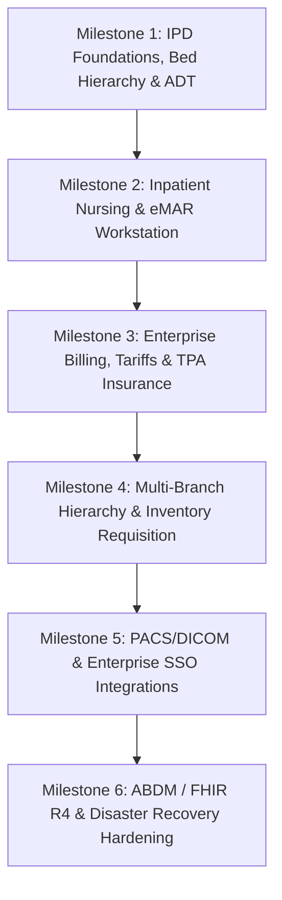

# MediPulse Enterprise Hospital Expansion Plan

**Document Version:** 1.0.0  
**Date:** 11 October 2026  
**Status:** Architectural Plan & Customer Alignment Proposal  
**Authors:** MediPulse Engineering & Clinical Systems Architecture  

---

## 1. Executive Summary & Purpose

MediPulse has completed its core outpatient (OPD), telemedicine, diagnostic laboratory, pharmacy fulfillment, and multi-tenant SaaS foundation (Phases P01 through P18). The platform successfully provides:
- Deterministic, atomic OPD queue and capacity scheduling with real-time Socket.IO synchronization.
- Clinician documentation, draft SOAP notes, and encounter journey tracking (P11, P12).
- Continuous patient queue tracking and privacy-safe hospital waiting room kiosk displays (P13).
- Dual-role independent doctor and hospital practice isolation (P14).
- Encounter-integrated laboratory catalog, accessioning, supervisor verification, and versioned amendments (P15).
- Hospital pharmacy inventory with batch expiration tracking, atomic dispensing, returns, and QR token verification (P16).
- SaaS tenant onboarding with expiring 48-hour setup links, plan entitlement enforcement, and privacy-safe operational metrics (P17).
- Audited AI reliability with deterministic red-flag emergency overrides, bounded timeouts, data minimization, and mandatory draft states requiring qualified clinician approval (P18).

This document establishes the **Enterprise Expansion Plan** for multi-specialty, multi-campus healthcare systems requiring Inpatient Department (IPD) operations, bed management, nursing station task automation, insurance/TPA claims adjudication, enterprise procurement, PACS/DICOM imaging boundaries, and high-availability enterprise governance.

---

## 2. Capability Audit: Shipped Pilot vs. Enterprise Inpatient Reality

The table below contrasts currently validated workflows with enterprise requirements:

| Hospital Functional Area | Current Shipped Status (P01–P18) | Enterprise Inpatient Scope (P19 Target) | Gap / Requirement |
|---|---|---|---|
| **Outpatient / OPD** | Production-ready: Multi-department, doctor schedules, atomic tokens, live queues, ETA ranges. | High-throughput bulk clinics, sub-specialty clinics, token paging systems. | Add multi-counter display and automated IVR/SMS queue calling. |
| **Emergency / Triage** | Rule-based red-flag detection, urgency grading (ROUTINE, URGENT, EMERGENCY), walk-in tickets. | Dedicated Emergency Department (ED) tracking, resuscitation bay management, trauma team paging. | Formalize ED bed occupancy, ambulance intake logs, and rapid-response escalation. |
| **Inpatient (IPD) & Beds** | Abstract encounter journey steps; no ward/bed schema. | Full ward hierarchy, room types, bed state machine, daily bed-day billing. | **Missing**: Ward, Bed, Admission, Transfer, Discharge (ADT) engine. |
| **Nursing Workflows** | Operational communication channels; role-based access. | Shift handover notes, vital signs charting, eMAR (Medication Administration Records), care plans. | **Missing**: Nursing shift worklists, vital trend graphs, 5-rights bedside medication verification. |
| **Laboratory / Diagnostics** | Shipped (P15): Tenant catalog, accession barcodes, supervisor verification, critical value alerts. | Analyzer direct bidirectional interfacing (ASTM/HL7), automated reflex testing, bulk analyzer worklists. | Integration interface boundaries with LIS/analyzer middleware (e.g., Roche, Abbott). |
| **Pharmacy & Formulary** | Shipped (P16): Batch expiry, atomic stock decrement, returns, encounter linkage, QR codes. | IPD floor stock requisition, automated drug-drug interaction screening, controlled substance double-signoff. | Floor ward stock transfer, narcotic ledger with dual-nurse PIN confirmation. |
| **Billing & Payments** | Shipped (P04, P17): Atomic wallet ledger, multi-doc transactions, modular SaaS billing adapter. | Inpatient advance deposits, tariff schedules, corporate insurance (TPA) pre-auth, final discharge clearance. | **Missing**: Tariff engine, split billing (patient co-pay + insurer claim), TPA workflow. |
| **Imaging / PACS** | Document upload / attachments in patient records. | DICOM study metadata linking, Web-based zero-footprint PACS viewer integration, radiology worklists. | **Missing**: Orthanc/dcm4chee DICOM web integration boundary, modality worklist (MWL). |
| **Multi-Branch Hierarchy** | Single-hospital multi-department tenancy with plan entitlements. | Multi-campus enterprise tenant with headquarters consolidation and branch-level inventory/staff transfer. | Enterprise organization model with campus branches and consolidated reporting. |
| **Security & Identity** | Host-only HttpOnly sessions, CSRF protection, RBAC (7 roles). | Enterprise Single Sign-On (SAML 2.0 / OIDC), active directory sync, role delegation, immutable audit trail. | Okta/Azure AD SSO adapter, SCIM provisioning, immutable append-only compliance logs. |
| **Disaster Recovery** | Single-cluster replica-set MongoDB, Redis DB 15, Kafka worker. | Cross-region read replicas, automated backup validation, RPO < 15 min, RTO < 1 hr. | Documented backup rehearsal runbooks, PITR validation, regional failover procedure. |

---

## 3. Phased Implementation Roadmap

To maintain clinical reliability without risking regression or unwieldy architectural changes, enterprise capabilities are organized into **6 sequential, bounded milestones**:



---

### Milestone 1: Inpatient Department (IPD), Bed Hierarchy & ADT Engine

**Objective:** Deliver core inpatient admission, bed management, transfers, and discharge clearing.

#### Data Architecture:
- `Ward`: Belongs to `Hospital`. Fields: `name`, `code`, `floor`, `building`, `genderPolicy` (`all`, `male`, `female`, `pediatric`), `nurseStationId`, `isActive`.
- `Room`: Belongs to `Ward`. Fields: `roomNumber`, `roomType` (`general`, `semi_private`, `private`, `deluxe`, `icu`, `isolation`), `dailyTariffMinor`.
- `Bed`: Belongs to `Room`. Fields: `bedNumber`, `status` (`available`, `reserved`, `occupied`, `cleaning`, `maintenance`), `currentEncounterId`, `maintenanceNote`.
- `IpdAdmission`: Encounter document linking patient, admitting consultant doctor, primary nurse, ward, bed, admitting diagnosis, advance deposit reference, estimated length of stay.
- `BedTransferRecord`: Audited history of every bed change: `fromBedId`, `toBedId`, `transferredBy`, `transferReason`, `effectiveTimestamp`.

#### State Machine (Bed Lifecycle):
```
[available]  --> (Patient Admitted)  --> [occupied]
[occupied]   --> (Transfer Out)       --> [cleaning] --> (Housekeeping Ready) --> [available]
[occupied]   --> (Discharge Cleared)  --> [cleaning] --> (Housekeeping Ready) --> [available]
[available]  --> (Scheduled Maint.)  --> [maintenance] --> (Inspected)         --> [available]
```

#### Acceptance Criteria:
1. Two simultaneous admission requests for the same bed resolve safely: one acquires the bed atomically in a Mongo transaction, the second receives an explicit 409 Conflict.
2. Patient transfers update bed statuses atomically: previous bed transitions to `cleaning`, target bed becomes `occupied`, transfer audit entry created.
3. Discharge cannot finalize until pharmacy pending items and billing clearance are marked as completed.

---

### Milestone 2: Inpatient Nursing Worklists & eMAR Workstation

**Objective:** Provide nursing stations with shift handover logging, vital signs trends, and 5-rights bedside medication administration.

#### Workflows:
1. **Nurse Shift Handover:** Structured shift log (`shiftDate`, `shiftType: morning/evening/night`, `outgoingNurse`, `incomingNurse`, `criticalObservations`, `codeEvents`).
2. **Vital Signs Flowsheet:** High-frequency recording (Pulse, BP, Respiratory Rate, SpO2, Temperature, Pain Score 1–10, Urine Output). Real-time National Early Warning Score (NEWS2) calculation flagging deteriorating patients.
3. **eMAR (Electronic Medication Administration Record):**
   - Directly linked to clinician prescriptions from P16.
   - Nurse records administration event: `medicationId`, `doseGiven`, `route`, `administeredAt`, `nurseSignature`.
   - 5-Rights Verification: Right Patient, Right Drug, Right Dose, Right Route, Right Time.
   - Controlled substances (Schedule II/X) require secondary nurse PIN verification before dispensing.

#### Acceptance Criteria:
1. Patient vitals calculate NEWS2 score deterministically: score >= 5 automatically alerts the attending on-call physician.
2. Missed medication doses require mandatory cancellation/omission reason (e.g., patient fasting for procedure, patient refused).

---

### Milestone 3: Enterprise Billing, Tariffs, Insurance TPA & Claims

**Objective:** Multi-payer billing engine supporting insurance pre-authorization, bed-day auto-accrual, and split payments.

#### Capabilities:
1. **Dynamic Tariff Catalog:** Configurable rate cards per room category (e.g., ICU rate vs General Ward rate for doctor consultations and nursing fees).
2. **Bed-Day Auto-Accrual:** Scheduled daily job calculating daily room rent and nursing charges accrued at midnight in tenant local timezone.
3. **TPA & Corporate Insurance Workflow:**
   - Policy details recording: Insurer name, TPA card number, pre-authorized amount, co-pay percentage.
   - Interim billing statement generation for insurance enhancement requests.
4. **Final Discharge Clearance Gate:**
   - Patient discharge invoice calculates: Total Gross - TPA Approved - Cash Deposits = Balance Payable.
   - Gate prevents medical discharge summary release until finance clearance flag is confirmed.

---

### Milestone 4: Multi-Branch Campus Hierarchy & Bulk Procurement

**Objective:** Support multi-hospital corporate groups with branch delegation, shared master data, and central procurement.

#### Capabilities:
1. **Campus Hierarchy:** A single parent healthcare enterprise can manage multiple operating hospital branches (`main_campus`, `satellite_clinic_1`, etc.).
2. **Inter-Branch Stock Requisition:** Satellite pharmacies can issue stock transfer orders to the central warehouse, tracking in-transit quantities.
3. **Vendor Purchase Orders & GRN (Goods Receipt Notes):** Bulk drug procurement tracking vendor batch numbers, delivery challans, and price variance before stocking in pharmacy inventory.

---

### Milestone 5: PACS / DICOM Imaging & Enterprise SSO Integration

**Objective:** Seamless integration with hospital radiology networks and corporate identity providers.

#### Architecture Boundaries:
1. **PACS / DICOM Boundary:**
   - MediPulse does **not** store multi-gigabyte raw DICOM image blobs in MongoDB.
   - Hospital connects to a standard DICOM Archive (e.g., dcm4chee, Orthanc).
   - MediPulse stores imaging metadata (`StudyUID`, `AccessionNumber`, `Modality: CT/MR/XR`, `ReportSummary`) and provides an authenticated zero-footprint viewer link (e.g., OHIF Viewer or Orthanc Web Viewer) embedded in the patient medical record.
2. **Enterprise Single Sign-On (SSO):**
   - SAML 2.0 and OpenID Connect (OIDC) integration adapter for hospital Microsoft Entra ID (Azure AD), Okta, and Google Workspace.
   - Automatic user role provisioning via SCIM or SAML assertion attributes.

---

### Milestone 6: Disaster Recovery, ABDM Compliance & High Availability

**Objective:** Enterprise clinical safety, statutory compliance, and zero-data-loss resiliency.

#### Architecture:
1. **Disaster Recovery (DR) Targets:**
   - **Recovery Point Objective (RPO):** < 15 minutes via MongoDB continuous oplog archiving.
   - **Recovery Time Objective (RTO):** < 60 minutes for complete application cold-standby restoration.
   - Automated bi-weekly restoration drill verifying checksums of synthetic patient records.
2. **Indian ABDM (Ayushman Bharat Digital Mission) Compliance:**
   - Milestone M1: ABHA (Ayushman Bharat Health Account) creation and verification.
   - Milestone M2: Health Information Provider (HIP) — sharing diagnostic and prescription bundles over FHIR R4.
   - Milestone M3: Health Information User (HIU) — fetching consented external records via the consent manager.

---

## 4. Proposed Implementation Task Prompts for Milestone 1 (IPD & Bed Management)

When hospital stakeholders sign off on Milestone 1, development will proceed using the following prompts:

### Prompt M1.1 — Ward, Room, and Bed Data Architecture & Management
```text
Implement tenant-scoped Inpatient Ward, Room, and Bed hierarchy in MediPulse.
Create models Ward.js, Room.js, and Bed.js with tenant scoping, room categories, tariffs, and status states (available, occupied, cleaning, maintenance). Build administrative CRUD endpoints in backend/routes/ipd.js allowing hospital admins to configure floors, rooms, and bed counts. Enforce uniqueness on bed numbers within a ward. Include unit tests in backend/tests/bed-management.test.js.
```

### Prompt M1.2 — Inpatient Admission, Transfer & Bed State Machine
```text
Implement the atomic Inpatient Admission and Transfer state machine.
Create model IpdEncounter.js linking patient, admitting consultant, admitting diagnosis, bedId, and advance deposit. Build endpoints POST /api/ipd/admit and POST /api/ipd/transfer. Use atomic MongoDB transactions: assigning a bed verifies status is 'available' and sets it to 'occupied'; transfers transition the old bed to 'cleaning' and target bed to 'occupied'. Prevent concurrent over-allocation with E11000 or version check. Test concurrent admission conflict handling.
```

### Prompt M1.3 — Ward Bed Console & Housekeeping Clearance
```text
Build the Inpatient Bed Management and Housekeeping Console in frontend/src/pages/hospital-admin/BedManagementConsole.jsx using P08 design tokens.
Display an interactive floor-plan grid of beds color-coded by status (Green=Available, Red=Occupied, Yellow=Cleaning, Grey=Maintenance). Provide modal actions for Patient Bed Transfer, Maintenance Outage, and Housekeeping Ready Confirmation. Ensure accessible contrast, mobile-friendly card views, and real-time Socket.IO bed status synchronization.
```

---

## 5. Governance & Review Approval Gates

Prior to operational deployment of any Inpatient module, the following qualified approvals must be obtained:
1. **Hospital Medical Director:** Approval of clinical handover templates, eMAR 5-rights verification, and code escalation protocols.
2. **Hospital Legal & Compliance Officer:** Approval of statutory medical record retention policies (e.g., minimum 10 years for adult inpatient records, 25 years for pediatric records) and insurance audit trails.
3. **Platform Infrastructure Lead:** Verification of encrypted offsite backup retention and warm disaster-recovery site readiness.
